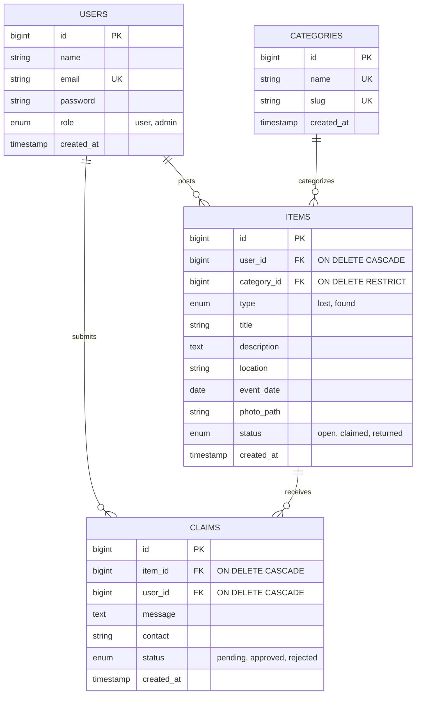

# Campus Lost & Found — Web Programming ETS Project (EF234301)

> A centralized campus portal where students and staff report lost or found items, submit ownership claims with proof, and reconnect belongings with their rightful owners.

[](https://laravel.com)
[](https://php.net)
[](https://tailwindcss.com)
[](LICENSE)

---

## 📌 Project Overview
* **Course:** Web Programming (EF234301) - Midterm Exam (ETS)
* **Architecture:** MVC with Laravel 12 & Eloquent ORM
* **Authentication:** Laravel Breeze (Blade Stack)
* **Database Schema:** 4 Entities (`users`, `categories`, `items`, `claims`) with 4 Foreign Keys and strict ON DELETE rules (`RESTRICT` & `CASCADE`).

---

## 👥 Demo Accounts
You can log in directly using the seeded demo accounts:

| Role | Email | Password | Privileges |
| :--- | :--- | :--- | :--- |
| **Admin** | `admin@lostfound.test` | `password` | Manage categories, moderate/delete any item |
| **User 1** | `budi@lostfound.test` | `password` | Post items, claim found items, review claims, dashboard |
| **User 2** | `siti@lostfound.test` | `password` | Post items, submit claims, review claims |
| **User 3** | `andi@lostfound.test` | `password` | Post items, submit claims, review claims |

---

## 🚀 Features (F1 – F11)

| # | Feature | CRUD | Description |
| :-: | :--- | :--- | :--- |
| **F1** | **Post Item** | Create | Post a lost or found item with title, category, description, campus location, date, and photo. |
| **F2** | **Item Feed** | Read | Responsive card grid with status badges (`Open`, `Claimed`, `Returned`) and pagination. |
| **F3** | **Item Detail** | Read | Complete details, high-res photo, reporter information, and contextual claim actions. |
| **F4** | **Edit Item** | Update | Author-only editing with automatic photo replacement and policy protection. |
| **F5** | **Delete Item** | Delete | Removes item, photo file, and cascades claims (Author or Admin). |
| **F6** | **Search & Filter** | Read | Query filters by keyword (`q`), report type (`lost`/`found`), category, and status. |
| **F7** | **Submit Claim** | Create | Non-owner users submit ownership proof (min. 20 chars) and WhatsApp/LINE contact. |
| **F8** | **Review Claims** | Update | Poster approves or rejects claims. Approving auto-rejects other pending claims and reveals contact. |
| **F9** | **Mark as Returned** | Update | Once claimed, the poster marks the item as returned, finalizing the lifecycle. |
| **F10** | **Category Management** | CRUD | Admin-only dashboard to add, rename, and delete categories (delete blocked if items exist). |
| **F11** | **User Dashboard** | Read | Real-time counts (total items, open, claimed, pending claims) and two management tables. |

---

## 🗄️ Database Design (Conceptual & Physical)

### Entity-Relationship Diagram (ERD)



### Foreign Keys & Constraints
1. `items.user_id` $\rightarrow$ `users.id` (`ON DELETE CASCADE`): Deleting a user removes their posted items.
2. `items.category_id` $\rightarrow$ `categories.id` (`ON DELETE RESTRICT`): Categories with active items cannot be deleted, preserving relational integrity.
3. `claims.item_id` $\rightarrow$ `items.id` (`ON DELETE CASCADE`): Deleting an item removes all associated claims.
4. `claims.user_id` $\rightarrow$ `users.id` (`ON DELETE CASCADE`): Deleting a user removes their claims.
5. Unique constraint on `claims(item_id, user_id)`: Prevents duplicate claims by the same user on a single item.

---

## ⚙️ Local Setup Instructions

### 1. Clone the repository
```bash
git clone https://github.com/Squash07/campus-lost-and-found.git
cd campus-lost-and-found
```

### 2. Environment Configuration
```bash
cp .env.example .env
```

### 3. Install Dependencies
```bash
php composer.phar install
# or: composer install
```

### 4. Generate Application Key
```bash
php artisan key:generate
```

### 5. Run Migrations & Seeders
```bash
touch database/database.sqlite
php artisan migrate --seed
```

### 6. Start Local Development Server
```bash
php artisan serve
```
Open **[http://localhost:8000](http://localhost:8000)** in your browser.

---

## 🔒 Security & Policies
* **Authorization:** Implemented via `ItemPolicy` and `ClaimPolicy` to block unauthorized URL manipulation with HTTP 403.
* **Middleware:** `EnsureUserIsAdmin` protects `/admin/*` routes.
* **Uploads:** Validated file types (`image/jpeg`, `image/png`), maximum 2 MB, stored in `public/uploads` for seamless deployment across standard shared hosting environments.
* **Database Transactions:** Approving a claim executes atomically within a `DB::transaction` block.
